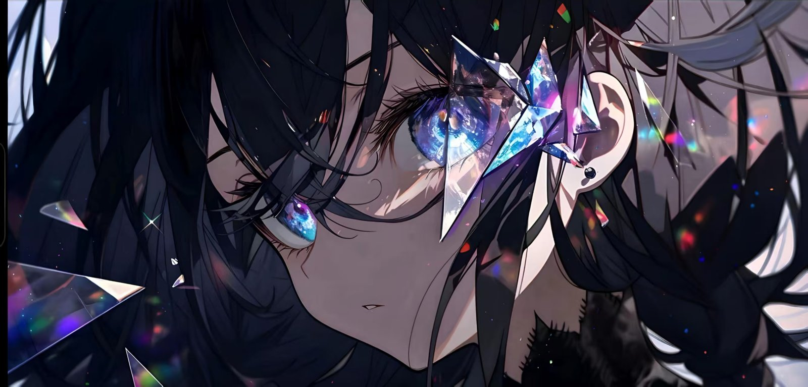
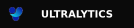

  

## About Me

<table>
  <tr>
    <td width="50%" valign="top">
      <b>FOCUS</b> 
      Robotics developer focused on ROS 2, computer vision and autonomous navigation. 
      Open to collaboration on robotics and open-source projects.
    </td>
    <td width="50%" valign="top">
      <b>BUILDING</b> 
      <b>Robotics_DevKit_Platform</b>
    </td>
  </tr>
  <tr>
    <td width="50%" valign="top">
      <b>LEARNING</b> 
      ROS 2
    </td>
    <td width="50%" valign="top">
      <b>CONTACT</b> 
      <a href="mailto:VoVL7732006@gmail.com">Email</a> · <a href="https://vovl773.github.io/">Blog</a>
    </td>
  </tr>
</table>

## Tech Stack

**Languages**

**Frameworks & Tools**

## Writing

I share notes, tutorials and thoughts on my blog.

<!-- 把上面的 https://your-blog.com 换成你的博客地址 -->

